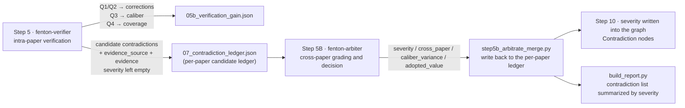

# Contradiction Taxonomy (v1 · finalized 2026-10-06)

> **This file is the single source of truth for contradictions across the whole workflow.** Step 5 (`fenton-verifier`), Step 5B (`fenton-arbiter`),
> `step4c_errata.py` / `step5b_arbitrate_merge.py` / `step10_graph_export.py` / `build_report.py`
> all refer to this specification; any class name that disagrees with it anywhere is a defect.

## 0. Why it changed

The old caliber mixed three systems into one `category`: **severity A–E** × **class E1/E2/E3/E5/text-text** × **carrier figure-text/table-text/text-text/table-table**,
and the letter `E` denoted both "the highest severity" and a "class prefix", which confused both human reading and statistics. It is now split into **two independent axes + one record field**.

| | Axis 1 · Severity | Axis 2 · Verification finding Q | Field · Evidence carrier |
|---|---|---|---|
| Answers | How serious is this contradiction? | How many errors did verification correct, and of what value? | Between which two material types the contradiction occurs |
| Values | A / B / C / D / E (+ 2 booleans) | Q1 / Q2 / Q3 / Q4 | text-vs-figure / text-vs-table / text-vs-text |
| Decided by | `fenton-arbiter` (**cross-paper**, Step 5B) | `fenton-verifier` (**intra-paper**, Step 5) | Whoever detects it labels it |
| Serves | The report's "contradiction list", graph review flags | The report's "verification gain" (C / e / R / Δ) | Traceability only, **never a classification** |

---

## 1. Axis 1: Severity of a genuine contradiction (the only classification)

| Level | Name | Criterion | Typical |
|---|---|---|---|
| **A** | Numerical deviation | Same order of magnitude and same direction, beyond tolerance (≥5% of the axis range or 5% relative, whichever is larger) | Text says 92% vs. figure 88% |
| **B** | Attribution / condition mismatch | The value itself is right but attached to the wrong sample, or temperature/pH/dose/time/catalyst dosage is misplaced | The 95% at 90 min is reported as the value at 120 min |
| **C** | Naming / numbering / counting error | Material name, figure number, experiment number or count is inconsistent | Text says Fig.7a while the caption says Fig.7b; "four groups" are in fact three |
| **D** | Conclusion refuted by its own data | A qualitative conclusion runs opposite to, or is unsupported by, the paper's own data | Claims "significantly enhanced" while the data show no difference |
| **E** | Other (unclassifiable) | A genuine contradiction with opposing values that **fits none of A–D** (cross-mechanism / method differences, purely qualitative statements with no numerical anchor, etc.), or **insufficient evidence to grade** | The text is qualitative only while the figure shows a numerical trend; the three grading prerequisites are not all met |

**Grading prerequisites (all three must hold)**:
1. The number has been verified as **not an extraction error** (Q1/Q2 excluded — we did not misread the figure or the text);
2. The source has been verified as **not an OCR artifact** (consistent with the origin PDF text layer);
3. The numerical difference is ≥5% of the axis range (or ≥5% relative, whichever is larger) — **anything within 5% is not a contradiction**.

**Two boolean flags (they do not consume a severity letter)**:

| Flag | Meaning | Note |
|---|---|---|
| `cross_paper=true` | The same experiment/material/pollutant contradicts between two **published sources** | The former "E level". **Undecidable intra-paper**; only corpus-wide visibility can decide it → hence it must be cross-paper |
| `caliber_variance=true` | Caliber difference (mineralization vs. removal, dry vs. wet weight, different basis/unit) | **Not a contradiction**: neither side is wrong; kept as an explanation and never enters the contradiction store |

**Ungradable → `severity="E"` (other · unclassifiable) + `needs_human_review=true`**; never force a grade and never leave it empty.
E is still a genuine contradiction (it has opposing values/positions); it simply does not belong to A–D, and is re-graded into A–D after manual review.

> **`unknown` has been retired** (2026-10-06): `E` now carries both "not A–D" and "not yet gradable".
> The whole chain (`step4c` / `step5b` / `step10` / `build_report` / every subagent) emits **only the five values A–E**;
> any `unknown` left in historical data is **normalized to `E` on read/write-back**, with `needs_human_review=true` preserved.

---

## 2. Axis 2: Verification finding Q (the Step 5 scorecard)

Q is decided intra-paper by `fenton-verifier` and **measures how many errors verification corrected for us and how much accuracy it added**.

| Code | Meaning | Counts toward correction gain | Destination |
|---|---|---|---|
| **Q1** | Our **figure-reading error** (crop/caption misalignment, wrong value read from a figure) | ✅ | `04_internal_corrections.json`; the corrected value is written back |
| **Q2** | Our **text/table-reading error** (transcription error, condition mismatch) | ✅ | `04_internal_corrections.json` |
| **Q3** | Caliber difference (different unit/basis/conversion; neither side is wrong) | ❌ | Flagged `caliber_variance=true`, kept out of the contradiction store |
| **Q4** | Consistent (dual sources agree, including within 5% of the range) | ❌ | Records `checked` only; counts toward coverage |

**Gain metrics** (with $N$ = total extracted records, $checked$ = records actually compared):

$$C=\frac{checked}{N}\quad e=|Q1|+|Q2|\quad R=\frac{fixed}{e}\quad \Delta=\frac{fixed}{N}$$

- $C$ coverage, $e$ our own errors found by verification, $R$ correction rate, $\Delta$ **= how much verification raised extraction accuracy**;
- Error rate before verification $e/N$ → after verification $(e-fixed)/N$, where $(e-fixed)$ is the residual risk;
- Persistence: per paper `05b_verification_gain.json`; the orchestrator merges them by union.

**Division of labour**: Q1/Q2 are **extraction corrections** and never enter the contradiction store; Q3 is a **caliber explanation** and never enters it either; Q4 is **coverage**.
Only candidates that still disagree after excluding Q1/Q2/Q3/Q4 are handed to Axis 1 for grading.

---

## 3. Field: evidence_source (evidence carrier, traceability only)

`text-vs-figure` (formerly figure-text) / `text-vs-table` (formerly table-text) / `text-vs-text` (formerly text-text) / `figure-vs-table` (formerly figure-table)
— **downgraded from a classification to a field**. The report may show it as a helper column, but must never classify "table-table / figure-text classes" from it.

---

## 4. Field-name mapping (old → new, for migrating historical data)

> **Already executed**: 3,519 historical graph contradictions were re-normalized in one command by `scripts/step10b_clean_legacy.py` (idempotent, rerunnable);
> non-genuine contradictions were relabeled `:ContradictionArchived` and removed from the active set, and genuine ones were normalized; see Section 7.

| Old `category` value | New representation | Handling |
|---|---|---|
| `E1` | `q="Q1"` | Goes to corrections, **never into the contradiction store** |
| `E2` | `q="Q2"` | Same as above |
| `E3` / figure-text contradiction / `text-image` | `candidate=true`, `evidence_source="text-vs-figure"` | Enters candidates, awaiting arbiter grading |
| `E5` | `caliber_variance=true` | Not stored as a contradiction, annotation only |
| `text-text` / `text_text` / `TT` | `evidence_source="text-vs-text"` | Enters candidates, `severity` to be re-graded |
| table-text / `table-text` | `evidence_source="text-vs-table"` | Same as above |
| `A`/`B`/`C`/`D` | `severity` migrated as-is | Directly usable |
| `E` (the former cross-contradiction) | `cross_paper=true`, `severity` pending | Awaiting arbiter re-grading; **note**: the severity value **E** has been reassigned to "other (unclassifiable)" and has nothing to do with the old E level (cross-contradiction) |
| `consistent` / `dual_source` / `within_tolerance` / any "consistent (…)" | `q="Q4"` | Removed from the contradiction store |
| `unknown` (old fallback value) | `severity="E"` | Normalized to E (`unknown` retired) |
| empty | `severity="E"` | Pending backfill |

---

## 5. Position in the workflow (who does what, where)

- **Step 5 only emits candidates** (it is entitled to assign Q — that is its own output) and **decides neither authenticity nor grade**;
- **Grading + decision + cross-source judgement belong to Step 5B** (the supplementary step of cross-modal verification, immediately after Step 5; cross-paper, `fenton-arbiter`): the cross-source case cannot be decided intra-paper at all, and grading needs a consistent caliber;
- **Step 10** writes `severity` into the graph's Contradiction nodes.

---

## 6. Prohibitions (hard-coded)

1. Severity uses exactly **A / B / C / D / E** (E = other · unclassifiable, also the "cannot grade" fallback); `unknown` **is no longer a legal value** and is normalized to `E` on sight; `E` must never again carry the old "cross-contradiction" meaning (that case uses the `cross_paper=true` boolean);
2. Verification findings use **Q1–Q4** only;
3. The `category` field is **deprecated entirely**, replaced by `severity` + `q` + `evidence_source` + `caliber_variance` + `cross_paper`;
4. table-table / figure-text / text-text / table-text **may never serve as a class**, only as `evidence_source`.

---

## 7. Graph representation (Contradiction node schema)

After cleanup the graph retains **genuine contradictions only**. Fields and relationships (exported by `step10_graph_export.py` → imported by `step11_neo4j_import.py`):

| Property | Type | Note |
|---|---|---|
| `node_id` | string | `pid::K index` (per-paper numbering) |
| `paper_id` | string | **Owning paper** (redundant with the `DISPUTES` edge so a direct lookup never gets lost) |
| `severity` | string | `A` / `B` / `C` / `D` / `E` (E = other · unclassifiable, also pending adjudication; **no `unknown`**) |
| `severity_label` | string | Full readable label: `numerical deviation` / `attribution · condition mismatch` / `naming · numbering · counting error` / `conclusion refuted by own data` / `other (unclassifiable)` |
| `evidence_source` | string | `text-vs-figure` / `text-vs-table` / `text-vs-text` |
| `cross_paper` | boolean | Cross-paper exclusion (the former E level) |
| `caliber_variance` | boolean | Caliber difference (not a contradiction, explanation retained only) |
| `text_value` / `image_value` / `adopted_value` | any | Text value / figure (table) value / adopted value |
| `field` / `figure` | string | Field name / figure-number location |
| `reason` / `confidence` | string | Adjudication reason / confidence |
| `trace` | string | `paper_id / title / field / figure number` — **one-line traceability** |
| `needs_human_review` / `review_status` / `review_scope` | bool / string | `cross_paper` → `pending_arbitration` |
| ~~`category`~~ | — | **Deleted**; its reappearance in the graph is a defect |

Relationships — **three anchor layers**, answering "which paper / which experiment / which figure":

| Edge | Target | Coverage requirement |
|---|---|---|
| `DISPUTES` | Paper | **Mandatory, 100% with zero orphans** (always locatable at paper level) |
| `FROM_EXPERIMENT` | Experiment | Best effort (the paper has a unique experiment and the field is decidable / the pollutant name matches uniquely) |
| `DISPUTED_IN` | Figure | Created when the figure number parses |

- Figure nodes are scoped per paper: `FIG::<paper_id>::FigureN`. The legacy `FIG::Figure5` was a **cross-paper shared node** that leaked figure numbers across papers; fixed;
- Non-genuine contradictions are **not DELETEd**: they are relabeled `:ContradictionArchived` + `archive_reason` + `archived_at`, and their `embedding` is `REMOVE`d,
  so they leave the Contradiction set and vector recall while remaining rollback-auditable (the only responsible approach when grading rules carry residual uncertainty);
- The seven rules for "not a genuine contradiction" (`ARCHIVE_RULES` in the script) ask one question only: **is there a mutually incompatible comparator value?**
