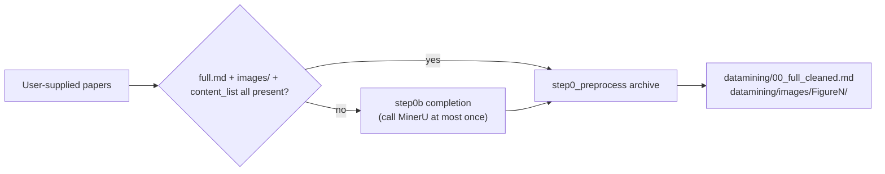

# Step 2: Parsing Completion and Archiving

> Prerequisite: papers from the Step 1 group with `decision = pass`.
> Executed by: the orchestrator runs scripts (pure scripts; no LLM calls).

The user may supply PDFs or pre-extracted MinerU folders. When MinerU outputs are missing, re-parse from the original PDF (or the folder's `*_origin.pdf`) to complete them; after parsing, fill in files to the canonical layout (based on folder and file names only, never on content).

Canonical layout:

```text
<paper_folder>/
├── full.md                  MinerU parsed full text
├── images/                  MinerU individual figures (hash filenames)
├── *_content_list.json      Caption ↔ image mapping
└── *_origin.pdf             Original PDF
```

Archive product specification (Step 4 packaging matches against this; do not change):

```text
datamining/images/FigureN/
├── FigureN.txt        Caption + ordered panel list `[i] <hash>.jpg page=N bbox=(...)` (order = caption a/b/c order)
├── <hash>.jpg         Panel blocks (one block per figure for multi-panel figures; filename = content_list image hash)
└── FigureN_full.jpg   Generated only when there are multiple blocks: the whole figure stitched in the original layout ("whole-figure pack" prefers this file)
```



## Command

Pass the user-supplied path **directly** (a PDF file, a paper folder, or a directory of papers all work). The script lives in this skill package under `scripts/`:

```bash
python scripts/step0_preprocess.py "<user-supplied path>"
```

One command performs three actions internally: bare PDF → create a sibling folder of the same name and **copy** the original into it (the original stays untouched) → complete missing MinerU outputs (called on demand, at most once) → clean the full text and archive figures.

- Figure archiving prefers cropping from the PDF using `content_list` bboxes (blocks stay complete and do not depend on individual images; the orchestrator never needs to look at an image). Only when no PDF exists does it fall back to archiving MinerU individual images. Idempotent; reruns overwrite.
- The token is read from the environment variables `MINERU_TOKEN` / `MINERU_API_KEY`, or from `workspace/mineru_config.json` (the script probes several common locations). Alternatively, parse with the `mineru-agent-parse` skill and then run `step0_preprocess.py`; both routes must produce the same product specification.

## Special cases in step0b

- If `images/` is still missing after completion, or the original PDF cannot supply the images → skip work-order generation, figure mining, and cross-modal verification, and go straight to Step 7 for text-only extraction.
- If the figures inside `images/` are wrong but the original PDF, `full.md` and `*_content_list.json` exist → rebuild the figures by cropping from the PDF using the bboxes in the existing content_list (zero misassignment).

## Pitfalls

1. **Entry condition**: `step0_preprocess.py` only accepts folders that have `full.md` and an `images/` directory; anything else is skipped silently.
2. **PDF naming**: `step0b` prefers `*_origin.pdf` and falls back to any `.pdf` in the folder.
3. **MinerU re-parsing overwrites**: when `full.md` is missing the whole set is replaced; the preservation logic only applies when only `images` is missing.

## Orchestrator close-out

Write `<paper_folder>/datamining/00_parse_archive.json` per paper:

```json
{
  "paper_dir": "…",
  "missing_before": ["images"],
  "action": "rebuild_from_pdf|mineru_reparse|none",
  "mineru_quota_used": false,
  "archive": {"figures_ok": 0, "total": 0, "unknown": 0},
  "full_cleaned_chars": 0,
  "warnings": [],
  "archived_at": ""
}
```

A high `unknown` count is a quality signal: record it in `warnings` and watch for caption misassignment downstream.

## Verification

1. The printed line shows `archived OK N/N`, with unknown far below N (all unknown = failure).
2. `datamining/00_full_cleaned.md` exists and is non-empty.
3. `datamining/images/` contains `FigureN/` folders with images and a same-named `.txt` description.
4. The source folder is unchanged except for completed MinerU outputs.

## Next

Verification passed → Step 3: work-order generation (`references/step3_work_order.md`).
