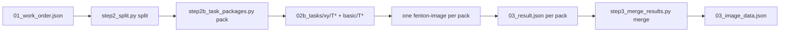

# Step 4: Figure Mining

> Prerequisite: Step 3 complete — `datamining/01_work_order.json` ready.
> Executed by: orchestrator scripts (split + pack) → one `fenton-image` per pack → orchestrator scripts (merge).



## Orchestrator scripts

The scripts live in this skill package under `scripts/` (cd there first if needed):

```bash
python scripts/step2_split.py "<paper folder or multi-paper directory>"
python scripts/step2b_task_packages.py "<paper folder or multi-paper directory>"
python scripts/step2c_verify_packages.py "<paper folder or multi-paper directory>"
```

`step2c` is the **packaging self-check**: it maps every pack image back to an archived panel and prints a "pack → subfigure → archive block → decision" table.
Identity relies on `image_source_md5` in task.json (the **source fingerprint**, not the md5 of the image inside the pack — re-encoding always changes the md5).
It is purely local (reads txt + computes md5), **never reads images, costs zero tokens**, and must run before dispatch.

> **Packaging implementation details** (lossless pass-through of the original image, multi-panel unpacking, the three image-acquisition tiers, per-pack structure) are documented in `fenton-image/system.md` and at the head of
> `scripts/step2b_task_packages.py`. The orchestrator only needs to remember two things: packing is done **at subfigure level** (xy and basic are packed separately), and
> `step2c_verify_packages.py` must pass **completely before dispatch**; rerunning `step2b` clears `02b_tasks/`, so persist finished results first.

## Dispatch (one per pack)

```
delegate_task(tasks=[
  {"profile": "fenton-image",
   "goal": "Extract data from the task-pack images: mode=xy reads coordinates point by point, mode=basic extracts characterization highlights",
   "context": "<task pack path>"},
  # one entry per pack
])
```

## Subagent return format

A JSON array plus a status line (format documented in the `fenton-image` subagent's system.md).

## Orchestrator close-out

1. Collect each pack's result and persist `03_result.json` into the corresponding task-pack directory;
2. Run `step3_merge_results.py` to merge everything into `03_image_data.json`;
3. Collect each pack's `archive_fix` → write the archive-correction list.

## Verification

1. Number of task packs = number of results (nothing missing), and every JSON parses;
2. Pack mode agrees with the subfigure-level fields in the work order: an xy pack contains only subfigures with `needs_xy_extraction=true`, a basic pack only those with `false`;
3. `step2c_verify_packages.py` passes completely: every pack image traces back to a panel block in `images/FigureN/` or to `FigureN_full.jpg` (never to a fragment),
   and the image's **actual index in the archive manifest == `panel_index`**; a whole-figure pack showing `whole figure (full) → not panel-level` and a re-encoded pack carrying "(re-encoded)" are both normal;
   any `MISMATCH` or "not traceable" must be fixed before dispatch;
4. xy records: every curve carries start and end points, and `xy_axes` carries the range and full tick list;
5. `archive_fix` entries have entered the archive-correction list;
6. Spot-check the values of several packs against the image.
