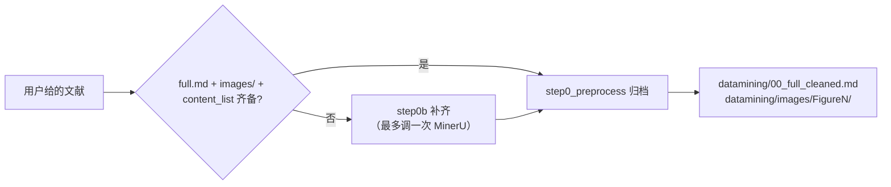

# 步骤二：解析补齐与归档

> 前置：步骤一批次中 `decision = pass` 的文献
> 执行：主控跑脚本（纯脚本，不调大模型）

用户给的文献可能是 PDF，也可能是已解压好的 MinerU 文件夹。缺 MinerU 产物时，用 PDF 原件（或文件夹下的 `*_origin.pdf`）再解析一次补齐；解析后按统一形态补文件（只看文件夹与文件名，不看内容）。

统一形态：

```text
<论文文件夹>/
├── full.md                  MinerU 解析正文
├── images/                  MinerU 散图（hash 文件名）
├── *_content_list.json      图注 ↔ 图片映射
└── *_origin.pdf             原始 PDF
```

归档产物规格（步骤四打包据此匹配，勿改）：

```text
datamining/images/FigureN/
├── FigureN.txt        图注 + 有序面板清单 `[i] <hash>.jpg page=N bbox=(…)`（顺序 = 图注 a/b/c 顺序）
├── <hash>.jpg         面板块（多面板图一图一块，文件名 = content_list 图片 hash）
└── FigureN_full.jpg   仅多块时生成：按原布局拼接的整图（「整图一包」优先取它）
```



## 命令

用户给的路径**直接传进去即可**（PDF 文件 / 论文夹 / 批次目录都行），脚本在本技能包 `scripts/` 下：

```bash
python scripts/step0_preprocess.py "<用户给的路径>"
```

一条命令内部做完三件事：裸 PDF → 在同级建同名夹并**复制**原件进去（原件不动）→ 缺 MinerU 产物才补齐（按需调用，最多一次）→ 全文清洗 + 图归档。

- 图归档优先用 `content_list` 的 bbox 从 PDF 裁剪（块完整、不依赖散图，主控无需读图）；无 PDF 时才退回 MinerU 散图归档。幂等，重跑直接覆盖。
- Token 取自环境变量 `MINERU_TOKEN` / `MINERU_API_KEY`，或 `workspace/mineru_config.json`（脚本自动探测多个常见位置）。也可用 `mineru-agent-parse` 技能解析后再跑 `step0_preprocess.py`，两条路产物规格须一致。

## step0b 特殊情形

- 补齐后仍缺 `images/`，或 PDF 原件也无法补齐图片 → 跳过工单生成、图像挖掘、图文互证，直接进步骤七做纯正文提取。
- `images/` 内的 figure 错，有 PDF 原件 + `full.md` + `*_content_list.json` → 按旧 content_list 的 bbox 从 PDF 裁图重建（零错配）。

## 坑

1. **入篇条件**：`step0_preprocess.py` 只认「有 `full.md` 且 `images/` 是目录」的文件夹，不满足则整篇静默跳过。
2. **PDF 命名**：`step0b` 优先 `*_origin.pdf`，退化为目录内任意 `.pdf`。
3. **MinerU 重解析会覆盖**：缺 `full.md` 时整套换新；保真逻辑只在「只缺 images」时生效。

## 主控收口

逐篇写 `<论文文件夹>/datamining/00_parse_archive.json`：

```json
{
  "paper_dir": "…",
  "missing_before": ["images"],
  "action": "rebuild_from_pdf|mineru_reparse|none",
  "mineru_quota_used": false,
  "archive": {"figures_ok": 0, "total": 0, "unknown": 0},
  "full_cleaned_chars": 0,
  "warnings": [],
  "archived_at": ""
}
```

`unknown` 偏多是质量信号，写进 `warnings`，后续步骤留意图注错配。

## 核验

1. 打印行出现 `归档OK N/N`，unknown 远小于 N（全 unknown = 失败）。
2. `datamining/00_full_cleaned.md` 存在且非空。
3. `datamining/images/` 有 `FigureN/`，内含图片 + 同名 `.txt` 描述。
4. 源文件夹除 MinerU 产物补齐外无改动。

## 下一步

核验通过 → 步骤三：工单生成（`references/步骤三_工单生成.md`）。
