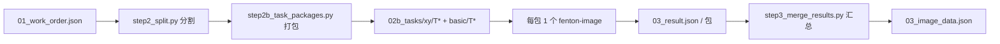

# 步骤四：图像挖掘

> 前置：步骤三完成——`datamining/01_work_order.json` 就绪
> 执行：主控脚本（分割 + 打包）→ 每包 1 个 `fenton-image` → 主控脚本（汇总）



## 主控脚本

脚本在本技能包 `scripts/` 下（不在该目录时先 cd 过去）：

```bash
python scripts/step2_split.py "<论文文件夹或批次目录>"
python scripts/step2b_task_packages.py "<论文文件夹或批次目录>"
python scripts/step2c_verify_packages.py "<论文文件夹或批次目录>"
```

`step2c` 是**打包自检**：把每包图反查回归档面板，输出「包 → 子图 → 归档第几块 → 判定」对照表。
身份靠 task.json 的 `image_source_md5`（**来源指纹**，不是包内图 md5 —— 重编码后 md5 必变）。
纯本地（读 txt + 算 md5），**不读图、零 token**，必须在派发前跑。

> **打包实现细节**（原图直通不降质、多面板拆包、取图三档、每包结构）见 `fenton-image/system.md` 与
> `scripts/step2b_task_packages.py` 头部说明 —— 主控只需记住两件事：打包按**子图级**分装（xy/basic 分开出包）、
> 必须**先跑 `step2c_verify_packages.py` 全绿再派发**；重跑 `step2b` 会清空 `02b_tasks/`，已提取结果先落盘。

## 派发（每包 1 个）

```
delegate_task(tasks=[
  {"profile": "fenton-image",
   "goal": "从任务包图像提取数据：mode=xy 逐点读坐标，mode=basic 提取表征要点",
   "context": "<任务包路径>"},
  # 每包一条
])
```

## 子智能体回报格式

JSON 数组 + 状态行（格式见 `fenton-image` 档案 system.md）。

## 主控收口

1. 收各包结果，逐包落盘 `03_result.json` 到对应任务包目录；
2. 跑 `step3_merge_results.py` 汇总为 `03_image_data.json`；
3. 收各包 `archive_fix` → 写归档修正清单。

## 核验

1. 任务包数 = result 数（无遗漏），全部 JSON 可解析；
2. 任务包 mode 与工单子图级字段一致：xy 包内只含 `needs_xy_extraction=true` 子图，basic 包只含 `false` 子图；
3. 跑 `step2c_verify_packages.py` 全绿：每包图可反查回 `images/FigureN/` 的某块面板或 `FigureN_full.jpg`（不得是碎片），
   且包内图在归档清单中的**实际序号 == `panel_index`**；整图包显示 `整图(full) → 非面板级`、重编码包带「（重编码）」均属正常；
   出现 `MISMATCH` / 「不可追溯」先修正再派发；
4. xy 记录：每条曲线含起点终点，`xy_axes` 带量程与全刻度；
5. `archive_fix` 条目已进归档修正清单；
6. 抽查若干包的数值与图面核对。
