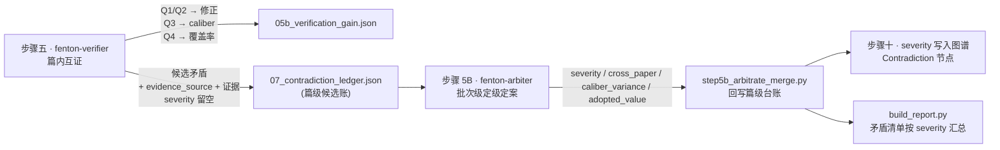

# 矛盾分类规范（v1 · 2026-10-06 定稿）

> **本文件是全流水线矛盾的唯一口径**。步骤五（`fenton-verifier`）、步骤 5B（`fenton-arbiter`）、
> `step4c_errata.py` / `step5b_arbitrate_merge.py` / `step10_graph_export.py` / `build_report.py`
> 一律引本规范，任何一处出现与本规范不一致的类别名即为缺陷。

## 零、为什么改

旧口径把三套体系混装成一条 `category`：**严重度 A–E** × **类别 E1/E2/E3/E5/text-text** × **载体图文/表文/文文/表表**，
而且 `E` 这个字母同时表示「严重度最高级」与「类别前缀」，人读与统计都乱。现拆成**两条互不相干的轴 + 一个记录字段**。

| | 轴一 · 严重程度 | 轴二 · 互证发现项 Q | 字段 · 载体来源 |
|---|---|---|---|
| 回答 | 这个矛盾有多严重 | 互证这一步纠了多少错、值多少 | 矛盾发生在哪两种材料之间 |
| 取值 | A / B / C / D / E（+ 2 个布尔） | Q1 / Q2 / Q3 / Q4 | text-vs-figure / text-vs-table / text-vs-text |
| 谁判 | `fenton-arbiter`（**批次级**，步骤 5B） | `fenton-verifier`（**篇内**，步骤五） | 谁发现谁标 |
| 服务 | 报告「矛盾清单」、图谱复核标记 | 报告「互证收益」（C / e / R / Δ） | 仅用于回溯定位，**不作分类** |

---

## 一、轴一：真矛盾严重程度（唯一分类）

| 级别 | 名称 | 判据 | 典型 |
|---|---|---|---|
| **A** | 数值偏差 | 同量级、方向一致，超容差（≥5% 量程或 5% 相对值，取大者） | 正文 92% vs 图 88% |
| **B** | 归属/条件错位 | 值本身对，但挂错样本，或温度/pH/剂量/时间/催化剂投加量错置 | 90 min 的 95% 被写成 120 min 的值 |
| **C** | 命名/编号/计数错 | 材料名、图号、实验编号、计数不一致 | 正文称 Fig.7a，图注写 Fig.7b；「四组」实为三组 |
| **D** | 结论被自身数据否定 | 定性结论与自家数据反向或无支撑 | 称「显著提升」，数据无差异 |
| **E** | 其他（无法归类） | 确为真矛盾、有对立值却**不属 A–D 任何一类**（跨机制/方法差异、仅定性描述无数值锚点等），或**证据不足以定级** | 正文仅定性描述但图有数值趋势；判级前置三条未凑齐 |

**判级前置（三条全满足才判级）**：
1. 数值已核实**非提取错**（Q1/Q2 已排除，即不是我们读错图/读错文）；
2. 原文已核实**非 OCR 伪影**（与 origin PDF 文本层一致）；
3. 数值差 ≥ 5% 量程（或 ≥5% 相对值，取大者）——**5% 内不是矛盾**。

**两条布尔标记（不占严重度字母）**：

| 标记 | 含义 | 说明 |
|---|---|---|
| `cross_paper=true` | 同一实验/材料/污染物在两个**已发表来源**间互相矛盾 | 原「E 级」。**篇内判不出**，只有批次/全库视野能定 → 由此必须放批次级 |
| `caliber_variance=true` | 口径差异（矿化率 vs 去除率、干重 vs 湿重、不同基准/单位） | **不是矛盾**：双方都没错，仅作解释留存，不进矛盾库 |

**判不了级 → `severity="E"`（其他·无法归类） + `needs_human_review=true`**，不得硬判、不得留空。
E 仍为真矛盾（有对立值/位点），只是性质不属 A–D；人工复核后归入 A–D 则改判。

> **`unknown` 已退场**（2026-10-06）：`E` 同时承担「不属 A–D」与「暂判不了」两种含义，
> 全链路（`step4c` / `step5b` / `step10` / `build_report` / 各子档案）只产 **A–E 五值**；
> 历史数据里残存的 `unknown` 在**读入/回写时归一为 `E`**，并保留 `needs_human_review=true`。

---

## 二、轴二：互证发现项 Q（步骤五的成绩单）

Q 由 `fenton-verifier` 在篇内判定，**度量互证这一步为我们纠正了多少、提升多少准确率**。

| 代码 | 含义 | 计入纠错收益 | 去向 |
|---|---|---|---|
| **Q1** | 我方**读图错**（裁图/图注编号错位、图被读错值） | ✅ | `04_internal_corrections.json`，修正值写回 |
| **Q2** | 我方**读文/读表错**（正文/表格转录错、条件对错） | ✅ | `04_internal_corrections.json` |
| **Q3** | 口径差（单位/基准/换算不同，双方都没错） | ❌ | 挂 `caliber_variance=true`，不进矛盾库 |
| **Q4** | 一致（dual_source 相符，含 5% 量程内） | ❌ | 只记 `checked`，进覆盖率 |

**收益指标**（记 $N$ = 抽取记录总数，$checked$ = 实际比对条数）：

$$C=\frac{checked}{N}\quad e=|Q1|+|Q2|\quad R=\frac{fixed}{e}\quad \Delta=\frac{fixed}{N}$$

- $C$ 覆盖率、$e$ 互证查出的自身错误数、$R$ 纠错率、$\Delta$ **= 互证把提取准确率抬高了多少**；
- 互证前错误率 $e/N$ → 互证后 $(e-fixed)/N$，$(e-fixed)$ 即残留风险；
- 落盘：篇级 `05b_verification_gain.json`，批次汇总由主控取并集。

**关键分工**：Q1/Q2 是**提取修正**，不入矛盾库；Q3 是**口径解释**，不入矛盾库；Q4 是**覆盖率**。
只有「排除 Q1/Q2/Q3/Q4 之后仍然对不上」的候选，才交给轴一定级。

---

## 三、字段：evidence_source（载体来源，只用于回溯）

`text-vs-figure`（原图文） / `text-vs-table`（原表文） / `text-vs-text`（原文文） / `figure-vs-table`（原图表）
——**从分类降级为字段**。报告里可作辅助列，但不得据此分「表表图文类别」。

---

## 四、字段名对照（旧 → 新，历史数据迁移用）

> **已实跑**：历史 3519 条图谱矛盾由 `scripts/step10b_clean_legacy.py` 一键重排（幂等可复跑），
> 非真矛盾换标签 `:ContradictionArchived` 出库、真矛盾归位，见第七节。

| 旧 `category` 值 | 新表示 | 处置 |
|---|---|---|
| `E1` | `q="Q1"` | 进 corrections，**不入矛盾库** |
| `E2` | `q="Q2"` | 同上 |
| `E3` / `图文矛盾` / `text-image` | `candidate=true`、`evidence_source="text-vs-figure"` | 进候选，等 arbiter 定级 |
| `E5` | `caliber_variance=true` | 不入矛盾库，只标注 |
| `text-text` / `text_text` / `TT` | `evidence_source="text-vs-text"` | 进候选，`severity` 待重判 |
| `表文` / `table-text` | `evidence_source="text-vs-table"` | 同上 |
| `A`/`B`/`C`/`D` | `severity` 原样迁移 | 直接可用 |
| `E`（原交叉矛盾） | `cross_paper=true`，`severity` 待定 | 等 arbiter 重判；**注意**：severity 取值 **E** 现已改派为「其他（无法归类）」，与旧 E 级（交叉矛盾）无关 |
| `consistent` / `dual_source` / `within_tolerance` / `一致（…)` | `q="Q4"` | 移出矛盾库 |
| `unknown`（旧兜底值） | `severity="E"` | 归一为 E（`unknown` 退场） |
| 空 | `severity="E"` | 待回填 |

---

## 五、流程位置（谁在哪一步做什么）

- **步骤五只出候选**（它本来就有资格给 Q —— 那是它自己的产出），**不定真伪、不分级**；
- **定级 + 定案 + 跨文献判定放在步骤 5B**（图文互证的补充步骤，紧随步骤五；批次级，`fenton-arbiter`）：跨文献那条篇内根本判不出来，且定级需统一口径；
- **步骤十**把 `severity` 写进图谱 Contradiction 节点。

---

## 六、禁用项（写死）

1. 严重度用 **A / B / C / D / E** 五值（E = 其他·无法归类，兼「判不了」兜底）；`unknown` **不再是合法值**，读到即归一为 `E`；不得再以 `E` 携带旧「交叉矛盾」含义（该场景用 `cross_paper=true` 布尔标记）；
2. 互证发现项只用 **Q1–Q4**；
3. `category` 字段**整体废弃**，由 `severity` + `q` + `evidence_source` + `caliber_variance` + `cross_paper` 取代；
4. 表表/图文/文文/表文 **不得作为类别**，只能作 `evidence_source`。

---

## 七、图谱落地（Contradiction 节点 schema）

清洗后图谱只保留**真矛盾**。字段与关系如下（`step10_graph_export.py` 导出 → `step11_neo4j_import.py` 入库）：

| 属性 | 类型 | 说明 |
|---|---|---|
| `node_id` | string | `pid::K序号`（篇内编号） |
| `paper_id` | string | **所属文献**（与 `DISPUTES` 边冗余，保证直查不迷路） |
| `severity` | string | `A` / `B` / `C` / `D` / `E`（E = 其他·无法归类，兼待裁决；**无 `unknown`**） |
| `severity_label` | string | 中文全称直读：`数值偏差` / `归属·条件错位` / `命名·编号·计数错` / `结论被自身数据否定` / `其他（无法归类）` |
| `evidence_source` | string | `text-vs-figure` / `text-vs-table` / `text-vs-text` |
| `cross_paper` | boolean | 跨文献互斥（原 E 级） |
| `caliber_variance` | boolean | 口径差（不算矛盾，仅留存解释） |
| `text_value` / `image_value` / `adopted_value` | any | 正文值 / 图(表)值 / 裁决采纳值 |
| `field` / `figure` | string | 字段名 / 图号位置 |
| `reason` / `confidence` | string | 裁决理由 / 置信度 |
| `trace` | string | `paper_id / 标题 / 字段 / 图号` —— **一行直读溯源** |
| `needs_human_review` / `review_status` / `review_scope` | bool / string | `cross_paper` → `pending_arbitration` |
| ~~`category`~~ | — | **已删除**，图谱里再出现即为缺陷 |

关系 —— **三层锚点**，回答「哪篇文献 / 哪个实验 / 哪张图」：

| 边 | 指向 | 覆盖要求 |
|---|---|---|
| `DISPUTES` | Paper | **必连，100% 零孤儿**（篇级永远可定位） |
| `FROM_EXPERIMENT` | Experiment | 尽力而为（该篇实验唯一且字段可判定 / 污染物名唯一命中） |
| `DISPUTED_IN` | Figure | 图号可解析时建立 |

- 图节点按论文限定：`FIG::<paper_id>::FigureN`。旧版 `FIG::Figure5` 是**跨论文共享节点**，会让图号串台，已修；
- 非真矛盾**不 DELETE**，改挂 `:ContradictionArchived` + `archive_reason` + `archived_at`，并 `REMOVE embedding`：
  既退出 Contradiction 集合与向量召回，又保留可回滚审计（判级规则有残余不确定性时，这是唯一负责的做法）；
- 判定为「非真矛盾」的七条规则（脚本内 `ARCHIVE_RULES`）判据只有一句：**有无互不相容的对照值**。
